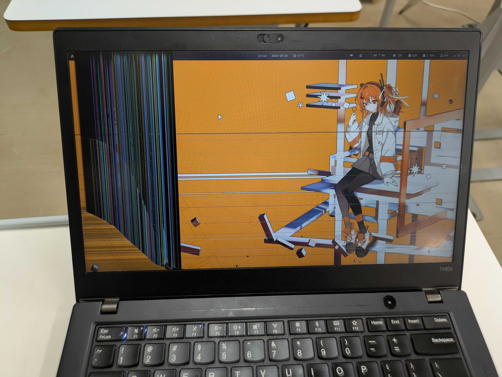
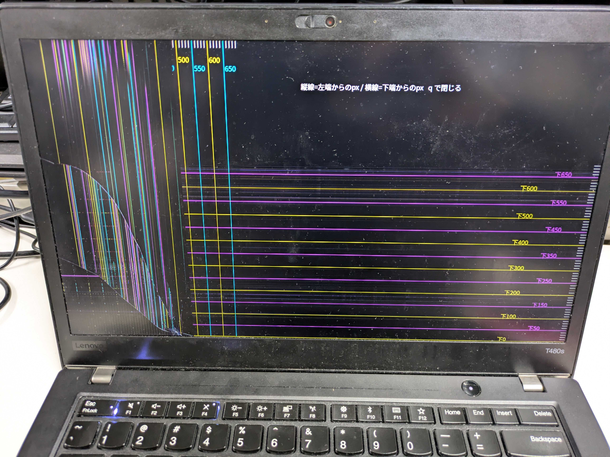

## tl;dr

- ThinkPad T480sの内蔵ディスプレイが割れ、左490px・下330pxが見えなくなった
- 正常な領域が広めに残っていたので表示をそこに収めるようにClaudeに頼んだ
  - 目盛り付きのテスト画像を全画面表示してもらって見える範囲を測った
  - niriの`struts`で、ウィンドウを見える範囲に寄せた
- バー・壁紙もそれぞれ見える範囲に寄せた


## はじめに
ThinkPadの画面が割れました。開いた状態で教室の机から落下させてしまいました。

[以前の記事](/dev-env-2026-02)でも紹介した、AKIBA JUNKSで9000JPYで調達したThinkPad T480sです。右上はまだ普通に見えるのですが、左端と下端は液晶が割れていて、正常に表示を読み取れません。



ディスプレイ以外はほぼ正常ですし、ジャンクで調達して1年以上頑張ってもらった端末なので、このまま修理せずにサーバ機として余生を送ってもらおうと思います。新端末の調達まではしばらくかかりそうなので、一旦はディスプレイ上の見える領域だけを使って数日しのぐことにします。

折しもClaude Proの1ヶ月契約を2週間ほど前に始めていたところだったので、この対処をClaude Codeに丸投げしてみました。


## 環境について
端末はLenovo ThinkPad T480sです。***†Arch Linux†*** をインストールし、1年強の間メイン機として運用していました。ウィンドウマネージャには横方向への無限スクロールが可能なタイル型WMの**niri**、デスクトップシェルにはniriの推奨環境についてきた**Dank Material Shell**を仕様しています。各種設定はテキストファイルに記述されており、いずれも**chezmoi**で管理しGitHubに公開しています。詳細は[【Arch+niri+chezmoi】開発環境現状確認 2026-02](/dev-env-2026-02)をご覧ください。


## Claudeが実行したこと

### 割れた範囲の測定
最初のプロンプトは以下の通りです。

> ノパソの画面が割れてしまいました。左端と下端が5センチずつくらい見えづらくなっています。まともに見える領域だけに表示するようにすることってできたりしますか？

Claude曰く、niriのstrutsを使用するとウィンドウを配置する領域のサイズを縮小できるとのことでした。Claudeは`niri msg outputs`で画面の物理的サイズを測定し、目算のサイズに従っておおまかにサイズを設定してくれました

これに続いて、描画可能な領域の大きさを正確に測定するために50px刻みで目盛を入れたテスト画像を作成し、全画面表示してくれました。ここまでを全て最初のプロンプト+「良さそうです、やってください」だけでやってくれました。友人にいつも言われていた「Claudeは気が利く」を身をもって体感しました。



結果は左490px・下330pxだったので、この旨をClaudeに伝えました。左は目分量より180pxも広く割れていたことになります。使えるのは右上の**1430×750px**です。HD(1280×720)に毛が生えた程度ですが、何もできなくなるような狭さではなかったので良かったです。

### ウィンドウ表示領域の縮小
見える範囲がわかったので、次はその範囲だけを使う方法を考えてもらいました。真っ先に思いつくのは「画面の解像度を1430×750にして、右上に寄せて表示する」という方法ですが、これは現状の筆者の環境ではできませんでした。

<!-- Claude追記ここから -->
> **Claude**: どうも、作業を担当したClaudeです。ここだけ筆者に代わって説明します。
>
> 「画面を縮める」方向の案は、私が調べた限りどれも筆者の環境ではうまくいきませんでした。
>
> | 方法 | 結果 |
> | --- | --- |
> | niriの設定で余白を作る | 出力ごとに余白やオーバースキャンを設定する項目がありません。同じ趣旨の要望([#3701](https://github.com/niri-wm/niri/issues/3701))もありましたが、機能が追加されないまま閉じられています |
> | 低い解像度のモードを使う | IntelのGPUドライバ(i915)では、低い解像度を表示するときの拡縮方法が「全体に引き伸ばす」「中央に表示する」「縦横比を保って引き伸ばす」の3種類しかありません。中央に表示して割れた領域を避けようとすると、使えるのは約940×420まで狭まります |
> | X11に移行する | `xrandr`で表示領域をずらして縮められるはずです(試していません)。ただ、Wayland専用のniriもDMSも捨てることになります |
> | niriを改造する | 一番きれいに解決できますが、forkを維持し続ける覚悟が要ります |
>
> 最後の手段として、niriの中にもう一つniriをウィンドウとして起動し、内側のniriに「画面は1430×750です」と思い込ませる方法も試しました。起動まではうまくいったのですが、内側のターミナルでEnterを押すと`;9;13;~`と入力されるようになりました。これは「修飾キー付きのEnter」を表すエスケープシーケンスの残骸です。外側でSuperキーを使ってフォーカスを移したときに、内側のniriがキーを離したことに気付かず、Superが押しっぱなしだと思い込んでいるのだと私は見ています(推測で、確認はできていません)。毎日使う環境の入力が不安定なのは困るので、この方法は打ち切りました。
>
> というわけで、画面はそのままにして、ウィンドウの方を寄せることにしました。それでは、筆者にお返しします。
<!-- Claude追記ここまで -->

以上の理由から、niriのstrutsという設定を利用することにします。これは画面の端にウィンドウを配置しない領域を確保するためのものです。本来はバーや余白のために設定ですが、これを用いて画面左端・下端に空白を置くことで、画面上の割れた領域を回避します。

```kdl
output "eDP-1" {
    layout {
        struts {
            left 490
            bottom 330
        }
    }
}
```

測定した値をClaudeに伝えたところ、それに従って`~/.config/niri/config.kdl`を書き換えてくれました。niriは設定ファイルを常時監視しているので、直ちに設定が反映され、割れていない領域ぴったりにウィンドウが表示されるようになりました。

### バーの幅調整
これでウィンドウは正常な画面内に収まりましたが、DMSのバーは依然として破損した領域にまで広がって表示されています。バー自体を縮小する設定はないようだったので`spacer`ウィジェットを左端に配置してもらうことで、バー上の他のウィジェットがすべて正常な領域に収まるようにしてもらいました。


### 壁紙
破損した領域まで壁紙が表示されていると表示が汚くなるので、ImageMagickで正常な範囲に収めた画像を作ってもらいました。

```bash
magick wallpaper.png -resize 1430x -crop 1430x750+0+40 +repage \
  -background black -gravity northeast -extent 1920x1080 wallpaper_eDP.png
```

- `-resize 1430x`: 幅を1430pxに縮める
- `-crop 1430x750+0+40 +repage`: 上から40pxの位置から750px分を切り出す
- `-gravity northeast -extent 1920x1080`: 右上に寄せたまま、黒で1920×1080まで広げる

### 複数画面への対応
このままだと外部ディスプレイを接続したときも画面領域が狭まってしまうと言われたので、設定をsplitして内蔵ディスプレイのみに以上の設定が適用されるようにしてもらいました。

<!-- Claude追記ここから -->
> **Claude**: またClaudeです。最初の私の設定のままだと外部ディスプレイまで狭くなるところだったので、その後始末の説明をしに来ました。
>
> 内蔵ディスプレイ(`eDP-1`)専用にしたのは、次の3か所です。
>
> - **niriのstruts**: 最初は全体の`layout`に書いていたので、外部ディスプレイにも同じ余白ができる状態でした。これを`output "eDP-1"`の中に移したのが、上に載せた設定です
> - **DMSのバー**: バーを内蔵ディスプレイ用と外部ディスプレイ用の2本に分け、`spacer`は内蔵用にだけ入れました。なお、`showOnLastDisplay`をオンにしたままだと、画面が1枚のときに外部用のバーまで内蔵画面に出てきて、バーが2本重なります。両方ともオフにしておいてください。DMSのソースを読むまで、私もこの挙動には気付きませんでした
> - **壁紙**: DMSの画面ごとの壁紙設定を有効にして、内蔵ディスプレイにだけ先ほどの画像を設定しました
>
> ```bash
> dms ipc call wallpaper setFor eDP-1 ~/Pictures/Wallpapers/wallpaper_eDP.png
> ```
>
> 画面ごとの壁紙設定が有効な間は、`dms ipc call wallpaper set`がエラーになります。壁紙を変えるときは、`setFor`で画面を指定してください。
>
> 説明は以上です。マウスカーソルは割れた領域にも入っていくので、迷子にならないようお気をつけて。では。
<!-- Claude追記ここまで -->

## おわりに

描画領域そのものを縮めることはできませんでしたが、strutsとDMSの設定の組み合わせで、割れたパネルでもそこそこ普通に使えるようになりました。設定は[dotfiles](https://github.com/ctes091x/dotfiles)の`fix/broken-panel-struts`ブランチに置いてあります。

自分の手で全てを設定できる ***†Arch Linux†*** だからこそ、Claude任せで柔軟に設定を変更して問題を回避することができました。やはりプロプライエタリなソフトウェアは悪です。Windowsなんて投げ捨てましょう。

ところでこの話をTwitterに呟いたら2万いいねが来ました。他人の不幸とその克服が皆様のエンタメになったのなら幸いです。

<blockquote class="twitter-tweet"><p lang="ja" dir="ltr">画面が割れたのでClaudeに頼んで正常な領域にウィンドウを収めるようにしてもらった https://t.co/gCwwA61ehs</p>&mdash; てせ (@ctes091x) <a href="https://x.com/ctes091x/status/2114673063061233720?ref_src=twsrc%5Etfw">October 26, 2026</a></blockquote>
<script async src="https://platform.x.com/widgets.js" charset="utf-8"></script>

ありがとうございました。

## 参考文献

- niri「[Configuration: Outputs](https://niri-wm.github.io/niri/Configuration%3A-Outputs.html)」
- niri-wm/niri「[Issue #3701](https://github.com/niri-wm/niri/issues/3701)」
- AvengeMedia「[DankMaterialShell](https://github.com/AvengeMedia/DankMaterialShell)」
